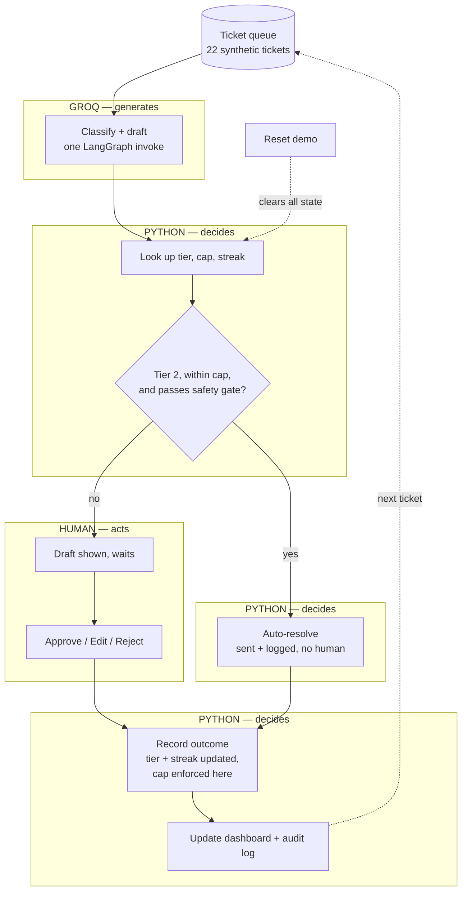

# agent-autonomy-journey

A support-ticket agent that starts under full human oversight and earns autonomy as its calls prove correct. [Try it](https://jayesh-agent-autonomy.streamlit.app/).

It's built around one rule, taken from a real trust-architecture framework: **slow to earn trust, fast to lose it.** Autonomy is earned per category, not granted globally — a category can take three approvals in a row to climb one tier, and loses it the moment a human edits or rejects a draft.

## What you're looking at

The tickets are fictional — 22 made-up SaaS support requests (password resets, billing questions, bug reports, cancellation threats) written to drive the demo, not real customer data. Clicking through them, you're playing the role of the human reviewer who checks an AI copilot's drafts before they go out: approve a good one, edit a slightly-off one, reject a wrong one.

What makes this an *agent* rather than a single LLM call behind a form: it runs as a real multi-step workflow (classify, then draft), it keeps a memory of its own track record per category and changes its behavior because of it, and at the highest earned tier it acts without asking — sending a reply and logging it, no human in that loop at all. An agent that always asks permission isn't exercising autonomy; this one gets to skip the human, but only inside hard, deterministic limits (`autonomy.py`) it can't talk its way around.



## How it works

Five ticket categories, each with its own independent autonomy tier:

| Category | Max tier |
|---|---|
| Password reset / account access | 2 (auto-resolve) |
| Feature request / how-to | 2 (auto-resolve) |
| Bug report | 2 (auto-resolve) |
| Billing question | 1 (always needs a human) |
| Cancellation or downgrade risk | 1 (always needs a human) |

Billing and cancellation are capped by design, not by accident — no amount of approval history lets them skip human review.

**Tiers:**
- **Tier 0 — Always Ask:** every draft waits for approve / edit / reject.
- **Tier 1 — Trusted Drafting:** still always asks, just with the UI showing the category has earned some trust.
- **Tier 2 — Auto-resolve:** eligible tickets are sent without waiting, logged for the audit trail.

**Graduation:** 3 consecutive clean approvals (unedited) promote a category one tier, up to its cap. **Demotion:** any single edit or rejection drops it one tier immediately. The asymmetry is the point.

**The Tier 2 gate** is a separate, deterministic check — not an LLM decision. Even at Tier 2, a ticket only auto-resolves if the classifier's confidence clears 0.85, the text contains none of a short safety denylist (fraud, hacked, lawyer, refund, someone else, etc. — illustrative, not exhaustive), and it reads as a single, simple request rather than a compound one. All four checks are in `autonomy.py`, covered by the test suite, and completely independent of what the model itself says.

**Two metrics, not one**, because they answer different questions:
- **Autonomy ratio** — `(clean approvals + auto-resolved) / total processed`. This is the book's own definition: the fraction of interactions that completed with zero human correction.
- **Human agreement rate** — `clean approvals / (clean approvals + edits + rejections)`. Excludes auto-resolved tickets entirely, so it only measures whether humans agree with what they actually see.

The first can climb because the system earned the right to skip people; the second can only climb because people keep agreeing with it. Showing only one would hide which is actually happening.

## Architecture

```
data/tickets.json    22 synthetic support tickets, deliberately ordered
autonomy.py           deterministic policy: tiers, promotion/demotion, the
                       Tier 2 gate, both metrics — zero LLM calls
agent.py               the only place an LLM is called: one LangGraph
                       invoke per ticket (classify, then draft)
app.py                  Streamlit UI, wires the two together
tests/test_autonomy.py  19 tests covering every rule above
```

One deliberate choice worth calling out: **this doesn't use LangGraph's interrupt/checkpoint machinery**, even though "human-in-the-loop" is the headline feature of that API. Streamlit already reruns the whole script on every click, which is itself the "waiting for a decision" state — a resumable, checkpointed graph would be solving a distributed-systems problem (pause a workflow, resume it later, don't double-count the resume) that a single-process app doesn't have. `agent.py` does one clean `invoke()` per ticket; everything about what happens with that output is a plain Python function in `autonomy.py`.

## Run locally

```bash
python -m venv .venv && source .venv/bin/activate
pip install -r requirements.txt
cp .env.example .env   # add your free Groq API key (console.groq.com)
pytest tests/          # 19 tests, no API key needed
streamlit run app.py
```

## Deploy for free

1. Push this repo to GitHub.
2. Go to [share.streamlit.io](https://share.streamlit.io), create a new app from this repo, `app.py` as the entry point.
3. Under **Settings → Secrets**, add `GROQ_API_KEY = "your-key-here"`.
4. Deploy.

## What this isn't

The safety denylist is illustrative, not a real content-safety system. Nothing here actually sends an email or touches a billing system — every "resolution" is simulated. The ticket set is synthetic and small by design, built to demonstrate the mechanic clearly in one sitting, not to be a statistically rigorous benchmark.
